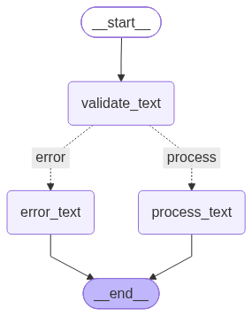

# Ch 7: First state graph

**What it does:** validate -> (error | process) with a conditional edge. Empty, non-text or too-long input goes to `error` and never reaches the LLM.
**When I'd use it:** Any time the next step depends on what a node found.

   

## Predictions 
| Input | My predicted final state | Actual |
|---|---|---|
| `""` | `"{'input_text': "", 'error_text': "Message is empty"}"` | `"{'input_text': '', 'error_text': "Message is empty"}"` |
| `"hello"` | `"{'input_text': 'hello', 'error_text': ''}"` | `"{'input_text': 'hello', 'error_text': ''}"` |
| `"x" * 150` | `"{'input_text': 'x'*150, 'error_text': ''}"` | `"{'input_text': 'x'*150, 'error_text': ''}"` |

## Gate
- [ ] I predicted the final state correctly for 3 inputs before running.
- [ ] `uv run pytest tests/test_ch07_graph.py` passes (both paths).
